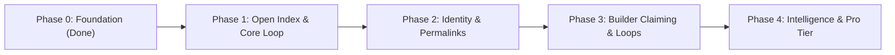

# Publisense Product & Engineering Roadmap

> [!IMPORTANT]
> **Strategic Thesis**: Win the **community and discovery layer first** (an open, high-craft index where users log friction, share wishlists, and exchange community workarounds for *any* product—without waiting for enterprise buy-in). Once community signal density is undeniable on `/p/:slug` boards, product teams naturally claim their boards to respond and close the loop.

---

## Phase 0 — Foundation & High-Craft Baseline *(Completed)*
- [x] **High-Craft Minimalist UI System** ([index.css](file:///C:/Users/user/Downloads/Base/Github/publisense/src/index.css), [ThemeContext.tsx](file:///C:/Users/user/Downloads/Base/Github/publisense/src/context/ThemeContext.tsx)): Obsidian Dark ↔ Alabaster Light themes, `1px` hairline geometry, `28px` workspace gutter, `Inter` + `JetBrains Mono`.
- [x] **Core Open Index & `/p/:slug` Product Pages** ([HomePage.tsx](file:///C:/Users/user/Downloads/Base/Github/publisense/src/pages/HomePage.tsx), [ProductPage.tsx](file:///C:/Users/user/Downloads/Base/Github/publisense/src/pages/ProductPage.tsx)): Symmetrical Hero, Central Omni-Bar (`Search /` ↔ `+ Post C`), Feed Filter Bar, and Right Discovery Rail (`Trending Products` + `Browse by Category`).
- [x] **Full-Width Signal Card + Bottom Upvote Pill Bar** ([SignalCard.tsx](file:///C:/Users/user/Downloads/Base/Github/publisense/src/components/SignalCard.tsx)): Highlighted `Top Community Workaround` (indigo) & `Builder Note` (emerald) callouts + inline expandable community threads.
- [x] **Live Supabase Relational Schema & Seed Catalog** ([schema.sql](file:///C:/Users/user/Downloads/Base/Github/publisense/supabase/schema.sql), [StoreContext.tsx](file:///C:/Users/user/Downloads/Base/Github/publisense/src/context/StoreContext.tsx)): Live tables (`organizations`, `products`, `profiles`, `posts`, `comments`, `post_votes`, `post_reposts`, `follows`) wired and seeded.

---

## Phase 1 — Open Index Polish & Frictionless Community Loop ✅ *(Completed)*
**Goal**: Make discovering products, logging friction, and surfacing community workarounds feel effortless and addictive for everyday software users.

| Milestone | Scope & Deliverables | Target Files |
| :--- | :--- | :--- |
| **1.1 Instant Product Indexing from Omni-Bar** ✅ *(Done)* | Allow users typing an unknown `@Product` directly in the Omni-Bar composer to create + tag that product inline in one step (auto-generating slug & category without leaving the composer). | [HomePage.tsx](file:///C:/Users/user/Downloads/Base/Github/publisense/src/pages/HomePage.tsx), [CreateProductModal.tsx](file:///C:/Users/user/Downloads/Base/Github/publisense/src/components/CreateProductModal.tsx) |
| **1.2 Upvoting & Pinning Workarounds** ✅ *(Done)* | Allow users to upvote individual replies/workarounds inside a thread (`likesCount`), automatically promoting the highest-upvoted `'workaround'` comment into the card's `Top Community Workaround` callout box. | [SignalCard.tsx](file:///C:/Users/user/Downloads/Base/Github/publisense/src/components/SignalCard.tsx), [StoreContext.tsx](file:///C:/Users/user/Downloads/Base/Github/publisense/src/context/StoreContext.tsx) |
| **1.3 Duplicate Detection in Omni-Bar** ✅ *(Done)* | As a user types a new signal headline in `+ Post` mode, show live matching existing signals below the bar so they can `+1 / Same Issue` an existing post instead of fragmenting votes. | [HomePage.tsx](file:///C:/Users/user/Downloads/Base/Github/publisense/src/pages/HomePage.tsx) |
| **1.4 Real-Time 7d Velocity Calculation** ✅ *(Done)* | Compute `7d Velocity` dynamically from `post_votes`, `post_reposts`, and new `posts` timestamps over the trailing 7 days rather than static baselines. | [HomePage.tsx](file:///C:/Users/user/Downloads/Base/Github/publisense/src/pages/HomePage.tsx), [StoreContext.tsx](file:///C:/Users/user/Downloads/Base/Github/publisense/src/context/StoreContext.tsx) |

---

## Phase 2 — Real Auth, Permalinks & Social Reputation ✅ *(Completed)*
**Goal**: Turn anonymous or demo interactions into durable user identity, shareable URLs, and contributor reputation.

| Milestone | Scope & Deliverables | Target Files |
| :--- | :--- | :--- |
| **2.1 Supabase Auth (Email / Magic Link / OAuth)** ✅ *(Done)* | Upgrade [`AuthModal`](file:///C:/Users/user/Downloads/Base/Github/publisense/src/components/AuthModal.tsx) to support real Supabase Email/Password, Magic Link, and GitHub/Google OAuth sessions with automatic `public.profiles` provisioning and session hydration. | [AuthModal.tsx](file:///C:/Users/user/Downloads/Base/Github/publisense/src/components/AuthModal.tsx), [StoreContext.tsx](file:///C:/Users/user/Downloads/Base/Github/publisense/src/context/StoreContext.tsx) |
| **2.2 Dedicated Signal Permalink View (`/post/:id`)** ✅ *(Done)* | Restyle [PostDetailPage.tsx](file:///C:/Users/user/Downloads/Base/Github/publisense/src/pages/PostDetailPage.tsx) to match the new high-craft aesthetic so shared links (`🔗 Share`) open a clean focused thread view with Maintainer Triage controls and related signals. | [PostDetailPage.tsx](file:///C:/Users/user/Downloads/Base/Github/publisense/src/pages/PostDetailPage.tsx), [App.tsx](file:///C:/Users/user/Downloads/Base/Github/publisense/src/App.tsx) |
| **2.3 Contributor Profiles (`/u/:handle`)** ✅ *(Done)* | Restyle [ProfilePage.tsx](file:///C:/Users/user/Downloads/Base/Github/publisense/src/pages/ProfilePage.tsx) as a "Product Sense Portfolio" showing a user's logged signals, authored workarounds, community impact, and backed products. | [ProfilePage.tsx](file:///C:/Users/user/Downloads/Base/Github/publisense/src/pages/ProfilePage.tsx) |
| **2.4 In-App Notifications Drawer** ✅ *(Done)* | Surface live notifications in `.topbar` when a signal you upvoted/reported gets a new Community Workaround or is marked `Shipped`. | [AppShell.tsx](file:///C:/Users/user/Downloads/Base/Github/publisense/src/components/AppShell.tsx), [StoreContext.tsx](file:///C:/Users/user/Downloads/Base/Github/publisense/src/context/StoreContext.tsx) |

---

## Phase 3 — Builder Claiming & Official Team Loops ✅ *(Completed)*
**Goal**: Give product makers and maintainers a dead-simple way to claim their `/p/:slug` board and close the loop publicly.

| Milestone | Scope & Deliverables | Target Files |
| :--- | :--- | :--- |
| **3.1 Domain-Verified Board Claiming** ✅ *(Done)* | Allow builders with a matching company email domain (e.g., `@cursor.com`, `@linear.app`) or DNS TXT verification to claim `/p/:slug` and earn the `✓ Verified Team` badge. | [HomePage.tsx](file:///C:/Users/user/Downloads/Base/Github/publisense/src/pages/HomePage.tsx), [StoreContext.tsx](file:///C:/Users/user/Downloads/Base/Github/publisense/src/context/StoreContext.tsx) |
| **3.2 Inline Maintainer Triage Controls** ✅ *(Done)* | Let verified maintainers update signal status (`Planned`, `In Progress`, `Shipped`) and post official emerald `Builder Notes` directly from [`SignalCard`](file:///C:/Users/user/Downloads/Base/Github/publisense/src/components/SignalCard.tsx). | [SignalCard.tsx](file:///C:/Users/user/Downloads/Base/Github/publisense/src/components/SignalCard.tsx) |
| **3.3 Changelog & "Shipped" Rollup Feed** ✅ *(Done)* | Dedicated filter/view on `/p/:slug` celebrating shipped community requests and measuring team responsiveness rate. | [HomePage.tsx](file:///C:/Users/user/Downloads/Base/Github/publisense/src/pages/HomePage.tsx) |

---

## Phase 4 — Signal Intelligence & Monetization *(Weeks 7+)*
**Goal**: Layer on AI synthesis and B2B workflow integrations once organic community traffic is established.

- **AI Signal Clustering & Deduplication**: Automatically group related friction reports into themes on `/p/:slug` (e.g., *"Context Window & Rules (14 signals)"*).
- **Embeddable "Public Sense" Widget**: A 1-script high-craft badge (`[▲ 92 Signals on Publisense]`) that indie hackers and SaaS teams can embed in their docs or footer.
- **Linear / GitHub / Slack Sync (Pro Tier for Teams)**: 1-click push from a high-velocity Publisense signal to a Linear issue or GitHub discussion, with automatic status sync when the issue closes.
