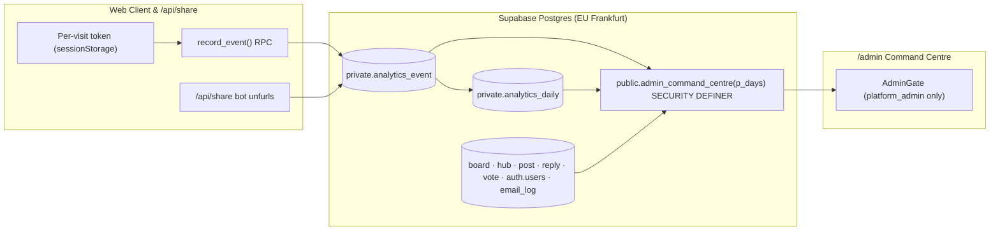

# Publisense v2: admin command centre & first-party analytics

> **Status:** planned, 2026-10-27. The Privacy Policy is **not** updated yet: update [`web/src/pages/LegalPages.tsx`](../../web/src/pages/LegalPages.tsx) in the same PR that ships `record_event`, so the policy never describes tracking that doesn't exist (keep the Vercel line "counts page views without cookies or personal identifiers"). Linked from [`BUILD.md`](./BUILD.md) and [`docs/archive/roadmap.md`](../archive/roadmap.md).

---

## 1. Why this exists

Publisense needs an operational command centre inside `/admin` so staff can see traffic, funnel conversion, catalog gaps, and feedback-loop health in one place without relying on third-party analytics dashboards.

Three constraints from [`FOUNDATION.md`](./FOUNDATION.md) and [`STATUS.md`](../../STATUS.md) shape the design:

1. **No advertising cookies, no consent banner, no ad-blocker blind spots.** Developer and product audiences block external trackers (e.g. `googletagmanager.com`) by default (Sentry already goes through the same-origin `/api/monitoring` tunnel since #182). Recording first-party events to our own Supabase project (EU Frankfurt) keeps data on our existing processor, requires no cookie banner, and cannot be silently dropped by third-party filter lists.
2. **Honest numbers (`D-011`).** Seeded/imported posts (`author_id IS NULL`) and member-authored posts (`author_id IS NOT NULL`) are never summed into a single headline traction counter without showing the split. Any external probe that is unconfigured degrades to `unknown`, never `0`.
3. **Security boundaries stay intact.** `service_role` never enters the browser bundle. All cross-table counts and event aggregations run inside a `SECURITY DEFINER` RPC guarded by `private.is_platform_admin()`.

---

## 2. Data sources

Metrics come from three layers:

### 2.1 Relational truth (existing tables, zero new instrumentation)

| Area | Source tables | Metrics derived |
|---|---|---|
| **Action queues** | `board`, `hub`, `report`, `ownership_dispute`, `join_request` | Pending products (`/admin/products`), pending companies (`/admin/companies`), open reports (`/admin/reports`), open disputes (`/admin/disputes`), pending team joins |
| **Traction & `D-011` split** | `auth.users`, `profile`, `post`, `reply`, `vote`, `follow` | Total & window deltas (24h / 7d / 30d); member posts (`author_id IS NOT NULL`) vs. imported posts (`author_id IS NULL`) |
| **Feedback-to-response loop** | `board`, `post`, `reply`, `status_event` | Claimed vs. unclaimed live boards; % of posts with an official reply (`reply.is_official = true`) or status transition; median time-to-first-response and time-to-shipped; post status distribution (`open`, `under_review`, `planned`, `in_progress`, `shipped`, `closed`, `merged`) |
| **Notifications & email** | `notification`, `notification_pref`, `email_log` | In-app read rate, email opt-out rate by notification kind, domain-code & batch email delivery counts |

### 2.2 First-party anonymous events (`private.analytics_event`)

A lightweight append-only table in the `private` schema (never directly readable or writable via PostgREST table endpoints).

| Column | Type | Notes |
|---|---|---|
| `id` | `bigserial primary key` | |
| `visit_id` | `uuid not null` | Random UUID held in `sessionStorage` for the tab's lifetime; rotates on tab close, never linked to `user_id`, email, or IP |
| `kind` | `text not null` | Checked against an explicit allow-list (see §3) |
| `board_id` | `uuid references public.board(id) on delete set null` | Optional board context (live boards only) |
| `hub_id` | `uuid references public.hub(id) on delete set null` | Optional hub context |
| `path` | `text` | Route path (`/` · `/explore` · `/b/:slug` · `/h/:slug` · `/post/:id`) |
| `referrer_host` | `text` | External hostname only (e.g. `news.ycombinator.com`, `google.com`, `x.com`), stripped of paths and query strings; `null` for same-origin or direct |
| `meta` | `jsonb not null default '{}'::jsonb` | Whitelisted by `record_event`: only `q` on `search_empty` (max 60 chars), `trigger` on `auth_open` (max 40 chars), `method` on `claim_verify_started` (strict enum, see below) and `reason` on `claim_verify_failed` (strict enum, see below); every other key and value is stripped. Payloads over 512 bytes are dropped |
| `at` | `timestamptz not null default now()` | Indexed by `(at desc)` and `(kind, at desc)` |

**Write path:**
* `public.record_event(p_visit_id uuid, p_kind text, p_path text, p_board_id uuid, p_hub_id uuid, p_referrer_host text, p_meta jsonb)` — `SECURITY DEFINER`, `search_path = pg_catalog, public, private`, executable by `anon` and `authenticated`. Silently drops unknown `kind` values or oversized `meta` payloads so client bugs never surface as errors, keeps only the whitelisted `meta` keys, and drops a `search_empty` whose term is under 3 characters or looks like contact details (contains `@`, an `x (at) y.tld` spelling, or a phone-like run of 7+ digits; `private.analytics_term_is_personal`, mirrored client-side by `looksPersonal()`).
* **Rate limits** (all silent drops): per visit token, 60 events per minute and 120 per 5 minutes; globally, 600 events per minute. `share_unfurl` is exempt from the per-visit caps because `/api/share` mints a fresh random token per unfurl.
* **Known limitation:** the visit token is chosen by the browser, so the per-visit caps bound volume per token, not per person. An anonymous caller can rotate tokens and inflate counts up to the global cap (600/min), and a flood can crowd out real events for that minute. Treat anonymous traffic numbers as indicative. A possible follow-up is a short-lived visit token signed server-side (e.g. an Edge Function issuing an HMAC'd token that `record_event` verifies); not built.
* [`web/api/share.ts`](../../web/api/share.ts) logs `share_unfurl` when crawlers (Slack, Discord, X, LinkedIn, Bluesky) fetch OpenGraph previews for a board, hub, or post. Each unfurl gets its own `crypto.randomUUID()` visit token, and the log is awaited with a 1.5 s timeout before the preview is answered, so Vercel doesn't cut the request off.

**Retention & rollup:**
* `private.rollup_analytics_events()` (nightly via `pg_cron` at 03:15 UTC when the extension is available; otherwise run it from a scheduled job) aggregates raw events older than 30 days into `private.analytics_daily (day, kind, board_id, referrer_host, detail, events, visits)`, deletes the raw rows and returns how many it deleted. It also writes a per-day `kind = 'visit'` total (distinct visit tokens that day). `detail` keeps one value per kind: the `auth_open` trigger, the `claim_verify_started` method and the `claim_verify_failed` reason (`private.analytics_detail`, which re-checks the enums); search terms are never rolled up.
* `analytics_daily.board_id` is a plain uuid with no foreign key: an `on delete set null` there would collide with an existing null-board bucket in the unique index and block board deletion. Rows for a deleted board simply stop joining.
* **Reads:** `admin_command_centre` reads every analytics figure through `private.analytics_buckets(since)`: days the rollup has absorbed come from `analytics_daily`, later days from raw events, split at the day after the newest rolled-up day, so the two never overlap. Visits are distinct visit tokens per UTC day, summed over the window (a tab left open across midnight counts on each day). Traffic, funnels, referrers, hot boards and sign-in triggers therefore cover the full 90-day window; **unmet search demand is raw-only (last 30 days)**, and the UI labels it so when 90d is selected.

---

## 3. Tracked events & funnels

| `kind` | Fired when | What it answers in `/admin` |
|---|---|---|
| `page_view` | Route changes in the SPA | Daily pageviews, visits (distinct visit tokens per day), external referrers |
| `share_unfurl` | Bot hits `/api/share` | Which boards and posts are being pasted into Slack, Discord, X, or iMessage |
| `search_open` | User opens `SearchWell` (`Cmd/Ctrl+K` or `/`) | Search usage frequency |
| `search_click` | User selects a board, post, or person in search | Search click-through rate |
| `search_empty` | Search query returns `0` results and has settled (debounced, then unchanged for 1.2 s), is 3+ characters and doesn't look like an email or phone number; once per term per search session (`meta.q`, max 60 chars) | **Unmet demand:** which products visitors expect to find on Publisense that should be seeded next |
| `claim_open` | Visitor opens `ClaimDialog` | Top-of-funnel builder interest per board |
| `claim_board_picked` | Visitor chooses a board in the generic claim modal | Which boards attract self-serve claims |
| `claim_auth_prompt` | Signed-out claimant clicks *Get started* to sign in/up | Sign-up wall conversion inside claiming |
| `claim_verify_started` | Claimant requests a work-email code or triggers DNS TXT check (`meta.method`: `email` or `dns`) | Verification attempts per board, email vs. DNS |
| `claim_verify_failed` | Verification attempt fails (`meta.reason`: a fixed error code, else `other`) | How often, and why, builders get stuck during verification |
| `composer_open` | User opens the feedback composer | Post intent volume |
| `similar_post_click` | User clicks an existing similar post suggested inside the composer | **Duplicate deflection rate:** how often suggestions prevent duplicate posts |
| `share_click` | User clicks Share on a post or board | Active user sharing rate |
| `auth_open` | `AuthDialog` opens (`meta.trigger`: the reason passed to `openAuth`, or the dialog mode) | Which actions convert anonymous visitors into registered accounts |
| `auth_link_expired` | Visitor lands on an expired or already-used email link (`AuthLinkErrorWatcher`) | Auth email friction rate |

---

## 4. `/admin` UI layout

Added to [`web/src/pages/AdminPages.tsx`](../../web/src/pages/AdminPages.tsx) inside `AdminGate` as the first pill in `AdminNav` (`/admin`, or `/admin/pulse`), using only the locked tokens in [`FOUNDATION.md`](./FOUNDATION.md) §3 (`font-mono` for all numbers, `--brand` cobalt for series bars, `--success` green strictly for *Shipped*, and inline SVG sparklines with no chart library).

1. **Window selector**: `7d` · `30d` · `90d` pill toggle in the header.
2. **Action queues strip**: 4 compact cards (*New products*, *Companies*, *Reports*, *Ownership disputes*) linking straight to their tabs; highlighted with `--border-strong` when count `> 0`.
3. **Scorecards & `D-011` honest split**:
   * **Visits & Pageviews** (with delta vs. previous window)
   * **Accounts** (total & new in window)
   * **Posts** (`N` from members · `M` imported, rendered separately)
   * **Votes & Replies** (with official reply count highlighted)
   * **Feedback Loop** (% of boards claimed · % of posts responded to · median time to first official response)
4. **Daily activity & traffic series**: Lightweight inline SVG bar/sparkline strips for *Visits*, *Signups*, *Member posts + votes*, and *Status changes*.
5. **Two-column operational tables**:
   * **Hot unclaimed boards** (outreach priority): Unclaimed live boards ranked by `views + claim_open + posts + votes` in the window.
   * **Unmet search demand**: Top `search_empty` queries with occurrence counts and a one-click *Add product* shortcut.
   * **Claim & composer funnels**: Step-by-step bar showing conversion from `claim_open → verify_started → claimed` and `composer_open → similar_post_click / post_created`, plus the claim verification split (work-email code vs. DNS TXT) and failed verifications by reason. Both read `analytics_daily.detail` for rolled-up days, so they cover the full 90-day window.

### Claim-funnel detail enums (strict)

Claim meta is never free text. `record_event` keeps these values only, and `private.analytics_detail` re-checks them before anything reaches `analytics_daily.detail`. The lists live in `private.analytics_claim_method` / `private.analytics_claim_fail_reason` (0054) and `CLAIM_VERIFY_METHODS` / `CLAIM_VERIFY_FAIL_REASONS` in `web/src/api/analytics.ts`; change both together.

| Kind | Key | Allowed values | Anything else |
| --- | --- | --- | --- |
| `claim_verify_started` | `method` | `email`, `dns` (the `domain_challenge` / `verified_domain` method values, 0021) | stripped (meta `{}`; counts in neither half of the split) |
| `claim_verify_failed` | `reason` | `wrong_code`, `expired`, `too_many_attempts` (from `verify_domain_email`); `not_found`, `dns_failed`, `dns_unavailable`, `no_challenge` (from `check_domain_dns`); `sign_in` (both); `dns_slow` (client: DNS poll timed out); `network` (client: RPC call failed); `other` | mapped to `other` (unknown codes, free text, missing or non-string) |
   * **Top referrers & social unfurls**: External domains sending traffic and boards/posts unfurled via `/api/share`.

---

## 5. Build order

1. **Privacy Policy update** ([`web/src/pages/LegalPages.tsx`](../../web/src/pages/LegalPages.tsx)) — document individual first-party usage events (page path, referring site, zero-result search terms, step outcomes), grouped by a temporary per-tab visit token, kept 30 days then rolled into daily totals; no name, email or IP *(done)*.
2. **Schema & RPCs (`0054_v2_command_centre.sql` + rollback `0054_down.sql`)**:
   * `private.analytics_event` and `private.analytics_daily` tables
   * `public.record_event` and `public.admin_command_centre` `SECURITY DEFINER` RPCs
   * `pg_cron` retention rollup schedule
   * SQL tests (`supabase/tests/v2_command_centre_test.sql`): verify anon/member cannot call `admin_command_centre`, verify `record_event` allow-list & bounds, verify `D-011` member vs. imported post split, and verify `v2_definer_grants_test.sql` passes.
3. **Client & `/api/share` instrumentation**:
   * `web/src/lib/analytics.ts` (`getVisitId()`, `trackEvent()`, route-change listener)
   * Hook calls in `SearchWell.tsx`, `ClaimDialog.tsx`, `composer.tsx`, `AuthDialog.tsx`, `AuthLinkErrorWatcher.tsx`, and `web/api/share.ts`.
4. **Command Centre screen (`/admin` in `AdminPages.tsx`)**:
   * `useAdminCommandCentre(days)` hook in `web/src/api/`
   * `AdminOverviewPage` component, route registration in `routes.tsx` and `vercel.json`, and Vitest tests in `web/src/test/admin.test.tsx`.
