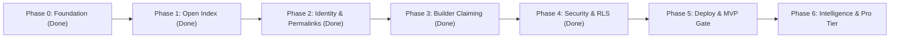

# Publisense — Product & Engineering Roadmap

> [!IMPORTANT]
> **Strategic Thesis**: Win the **community and discovery layer first** (an open, high-craft index where users log friction, share wishlists, and exchange community workarounds for *any* product—without waiting for enterprise buy-in). Once community signal density is undeniable on `/p/:slug` boards, product teams naturally claim their boards to respond, triage, and close the loop.



---

## Current Architecture & State

- **Frontend:** React 19 + Vite 6 + Tailwind 4, Obsidian Dark / Alabaster Light themes, hairline borders (`1px`), `Inter` + `JetBrains Mono` typography.
- **Backend:** Supabase (Postgres + Auth, project `wyjfgrgxmhumyzwcrywj`, region `eu-central-2`).
- **Canonical host:** https://publisense.app (Supabase `site_url` and redirect allow-list point here; `publisense.vercel.app` still resolves).
- **Data Model:** 12 tables (`organizations`, `products`, `profiles`, `posts`, `comments`, `comment_votes`, `post_votes`, `post_reposts`, `follows`, `notifications`, `claim_decisions`, `email_log`) + `public_profiles` secure view.
- **Access Control:** Production RLS with 37 scoped policies, `handle_new_user` trigger for signup profile creation, and `guard_profile_privileges` privilege escalation prevention.
- **Auth:** email + password, magic link (behind `VITE_AUTH_MAGIC_LINK`), and Google OAuth. Password reset works end to end (D-013/D-014, PR #62). GitHub is **not** enabled on the project, so it is never offered.
- **Build Status:** `tsc --noEmit` 0 errors; `vite build` clean; `npm test` 96 cases in CI.

---

## Phase 0 — Foundation & High-Craft Baseline ✅ *(Completed)*

- [x] **High-Craft UI System** ([`index.css`](./src/index.css), [`ThemeContext.tsx`](./src/context/ThemeContext.tsx)): Obsidian Dark ↔ Alabaster Light themes, `1px` hairline geometry, `28px` workspace gutter, `Inter` + `JetBrains Mono`.
- [x] **Core Open Index & `/p/:slug` Product Pages** ([`HomePage.tsx`](./src/pages/HomePage.tsx)): Symmetrical Hero, Central Omni-Bar (`Search /` ↔ `+ Post C`), Feed Filter Bar, and Right Discovery Rail.
- [x] **Full-Width Signal Card + Bottom Upvote Pill Bar** ([`SignalCard.tsx`](./src/components/SignalCard.tsx)): Highlighted `Top Community Workaround` (indigo) & `Builder Note` (emerald) callouts + inline expandable community threads.
- [x] **Supabase Relational Database & Seed Catalog** ([`schema.sql`](./supabase/schema.sql), [`StoreContext.tsx`](./src/context/StoreContext.tsx)): 8 core relational tables + seed catalog. Firebase completely removed.

---

## Phase 1 — Open Index Polish & Frictionless Community Loop ✅ *(Completed)*

| Milestone | Scope & Deliverables | Target Files |
| :--- | :--- | :--- |
| **1.1 Instant Product Indexing from Omni-Bar** ✅ | Allow users typing an unknown `@Product` directly in the Omni-Bar composer to create + tag that product inline in one step (auto-generating slug & category without leaving the composer). | [`HomePage.tsx`](./src/pages/HomePage.tsx) |
| **1.2 Upvoting & Auto-Pinning Workarounds** ✅ | Users can upvote individual replies/workarounds (`likesCount`), automatically promoting the highest-upvoted `'workaround'` comment into the card's `Top Community Workaround` callout box. Persisted via `comment_votes` + a trigger-maintained `likes_count` (migration `0008`, PR #24 — previously the vote was silently dropped). | [`SignalCard.tsx`](./src/components/SignalCard.tsx), [`StoreContext.tsx`](./src/context/StoreContext.tsx) |
| **1.3 Duplicate Detection in Omni-Bar** ✅ | As a user types a new signal headline in `+ Post` mode, show live matching existing signals below the bar so they can `+1 / Same Issue` an existing post instead of fragmenting votes. | [`HomePage.tsx`](./src/pages/HomePage.tsx) |
| **1.4 Real-Time 7d Velocity Calculation** ✅ | Computes `7d Velocity` dynamically from `post_votes`, `post_reposts`, and new `posts` timestamps over the trailing 7 days, dynamically driving the Right Rail `Trending Products` leaderboard. | [`HomePage.tsx`](./src/pages/HomePage.tsx), [`StoreContext.tsx`](./src/context/StoreContext.tsx) |

---

## Phase 2 — Real Auth, Permalinks & Social Reputation ✅ *(Completed)*

| Milestone | Scope & Deliverables | Target Files |
| :--- | :--- | :--- |
| **2.1 Supabase Auth (Email / Magic Link / OAuth)** ✅ | Upgraded [`AuthModal`](./src/components/AuthModal.tsx) to support real Supabase Email/Password, Magic Link and Google OAuth sessions with automatic profile hydration. Provider buttons are rendered from the project's live `GET /auth/v1/settings`, so a provider the project has not enabled is never offered (GitHub is one of those). Google verified end to end 2026-10-22 — issue #5. | [`AuthModal.tsx`](./src/components/AuthModal.tsx), [`StoreContext.tsx`](./src/context/StoreContext.tsx) |
| **2.2 Dedicated Signal Permalinks (`/post/:id`)** ✅ | Dedicated permalink view ([`PostDetailPage.tsx`](./src/pages/PostDetailPage.tsx)) in the high-craft design system with expanded community threads, maintainer triage controls, and related board signals. | [`PostDetailPage.tsx`](./src/pages/PostDetailPage.tsx), [`App.tsx`](./src/App.tsx) |
| **2.3 Contributor Profiles (`/u/:handle`)** ✅ | "Product Sense Portfolio" page ([`ProfilePage.tsx`](./src/pages/ProfilePage.tsx)) showing a user's logged signals, authored workarounds, community impact score, and backed products. | [`ProfilePage.tsx`](./src/pages/ProfilePage.tsx), [`App.tsx`](./src/App.tsx) |
| **2.4 In-App Notifications Drawer** ✅ | Topbar notification bell (`🔔`) with unread count badge, mark-all-read action, and direct navigation to `/post/:id` when signals receive workarounds or status changes. | [`AppShell.tsx`](./src/components/AppShell.tsx), [`StoreContext.tsx`](./src/context/StoreContext.tsx) |

---

## Phase 3 — Builder Claiming & Official Team Loops ✅ *(Completed)*

| Milestone | Scope & Deliverables | Target Files |
| :--- | :--- | :--- |
| **3.1 Domain-Verified Board Claiming** ✅ | Allows builders to claim their `/p/:slug` board via company work email domain, earning maintainer permissions after human approval. The write goes through `claim_product_board(p_product_id, p_work_email)` (`SECURITY DEFINER`, migration `0009`, PR #25) — the client never writes `role`. A claim **parks as `pending` and grants nothing**; approval is admin-only, and the review queue with approve/decline, decision log and claimant notification shipped 2026-10-21 (PRs #34, #36, #37 — `D-010`). | [`HomePage.tsx`](./src/pages/HomePage.tsx), [`StoreContext.tsx`](./src/context/StoreContext.tsx) |
| **3.2 Inline Maintainer Triage Controls** ✅ | Verified maintainers can update signal status (`Planned`, `In Progress`, `Shipped`) and author official emerald `Builder Notes` directly from [`SignalCard`](./src/components/SignalCard.tsx) in the feed. | [`SignalCard.tsx`](./src/components/SignalCard.tsx) |
| **3.3 Changelog & "Shipped" Rollup Banner** ✅ | Dedicated summary banner on `/p/:slug` celebrating shipped community requests, tracking team responsiveness rate, and closing the community feedback loop. | [`HomePage.tsx`](./src/pages/HomePage.tsx) |

---

## Phase 4 — Security, Integrity & RLS Lockdown ✅ *(Completed)*

Implemented in migrations `0004`–`0007`:
- [x] **RLS Lockdown (Migration `0006`)**: Replaced all permissive policies with 32 scoped policies: public read for content, `auth.uid()`-gated writes, recipient-only notifications.
- [x] **Signup Trigger (Migration `0004`)**: Added `handle_new_user` on `auth.users` to atomically provision a `profiles` row inside the transaction with handle de-duplication.
- [x] **Privilege Escalation Prevention (Migration `0007`)**: Added `guard_profile_privileges` trigger preventing users from patching their own role to `admin` or changing `managed_org_id`.
- [x] **Privacy Safeguard (Migration `0007`)**: Added `public_profiles` view omitting private email addresses from public reads; updated `StoreContext` loader.

---

## Verified production state (2026-10-22)

> [!IMPORTANT]
> Everything below was read out of the live project and the live host on 2026-10-22, not inferred
> from this document. Re-run the queries before any announce — this file is prose, the database is not.

**Catalog and content** (`wyjfgrgxmhumyzwcrywj`, unauthenticated read):

- 13 products, 7 organisations, 8 posts, 9 comments, 4 post votes, 0 comment votes, 0 claim decisions
- 10 profiles = **7 fixture personas** (`@publisense.invalid`) + **3 owner accounts**
  (`albertnkhata@hotmail.com`, `albertnkhata.s@gmail.com` — admin, email + Google —
  and `albert.n.sims@gmail.com` — Google). **No non-owner member exists**, so every visible signal
  and comment is still fixture content. `D-011`.
- all 13 products are `claim_status = 'unclaimed'`: no claim has ever been submitted, though the
  approval path itself is live and was exercised end to end on 2026-10-21 (`D-010`).

**Auth surface:**

- `/auth/v1/settings` reports `email: true`, `google: true`, everything else false; the client renders
  only enabled providers.
- Password reset works end to end and is owner-confirmed: mailed link → **New Password** step →
  password accepted → sign-in with the new password (`400 invalid_credentials` for the old one).
  `D-013` / `D-014`, PR #62, issue #61.
- Google sign-in owner-confirmed working 2026-10-22 (issue #5). The consent screen reads
  **Publisense** with `publisense.app/terms`, `publisense.app/privacy` and the support address, and
  shows no unverified-app interstitial — read from the screen's `ds:1` payload, since `app_domain=`
  only reflects the OAuth redirect host.
- Auth mail is sent from `auth@publisense.app` with SPF and DKIM passing and lands in the inbox.
- **Remaining cosmetic gap:** the consent-screen **logo** (`D-012`) — deferred by owner decision, and
  it must not be resubmitted while the mark is the generic speech-bubble glyph.

**Ship state:**

- `main` deployed to https://publisense.app (apex; `www` 308-redirects to it,
  `publisense.vercel.app` still serves the same build). Deep links work via SPA rewrites.
- Served entry chunk `assets/index-*.js` is ~117 kB; `vendor-react` (~223 kB) and
  `vendor-supabase` (~221 kB) load in parallel and cache independently, each page is its own async chunk.
- CI (typecheck, 96 unit tests, build, `service_role` bundle guard, migrations against stock Postgres)
  is green on `main`.

**Still open, in priority order:**

1. **Every visible signal and comment is fixture content** — 8 posts, 9 comments, 7 personas,
   zero non-owner members. Accepted by owner decision 2026-10-20 while the product is polished;
   **must be revisited before any announce.** `D-011`.
2. **`smoke:live` is a manual pre-ship step, not a CI gate** — it needs the service role, so the
   14 live RLS/auth checks only run when someone remembers. `D-003`.
3. **No server-side consumer for `service_role`** — the key exists for admin/ops use only. `D-002`.
4. **Cosmetic:** consent-screen logo (`D-012`), and background rows for other users carry no email in
   the client (`D-007`).

Browsing, posting signals, commenting, signal voting, workaround upvoting, board claiming and the
claim review queue all work end to end in production.

### Running the checks

```
npm test          # unit: auth-capability rules, recovery signal, claim queue (CI, 96 cases)
npm run typecheck # types (CI)
npm run build     # bundle + service_role guard (CI)
npm run smoke:live # live auth + RLS canary; creates a throwaway user, removes it
```

`smoke:live` talks to the production project on purpose. It prints a baseline count
for every table it touches and fails if the counts do not match on the way out; run it
with `-- --keep` to leave the identity behind for inspection.

---

## Phase 5 — MVP Deploy Gate ✅ *(Completed)*

See [`MVP.md`](./MVP.md) and [`docs/deferred.md`](./docs/deferred.md) for shipping criteria.

All five "must ship" items in `MVP.md` are satisfied: RLS locked down, signup provisioning via
`handle_new_user`, auth email deliverable, a real deploy target, and a bundle with no `service_role`.
What is left before an **announce** is no longer engineering:

- decide what happens to the fixture catalog (`D-011`) — a stranger arriving today sees 8 seeded
  signals and no other members;
- accept or close the two standing risk items (`D-002`, `D-003`).

- [x] **Wire Remaining Page Routes**:
  - `ExplorePage.tsx` (`/explore`), `OrgPage.tsx` (`/org/:slug`), and `SettingsPage.tsx` (`/settings`) routed in [`App.tsx`](./src/App.tsx) and linked via [`AppShell.tsx`](./src/components/AppShell.tsx).
- [x] **Deploy V2 to Production**:
  - Deployed to Vercel with [`vercel.json`](./vercel.json) SPA rewrites, security headers, and production Supabase environment variables.
  - Custom domain **https://publisense.app** is live on the same project (`www.publisense.app` 308-redirects to the apex); `publisense.vercel.app` keeps serving as the fallback host.
- [x] **Auth Email Cleanup (D-005)**: Supabase SMTP runs through Resend on the app's own verified domain — sender `Publisense <auth@publisense.app>`, SPF/DKIM passing, delivered to the inbox. Magic link is enabled and email confirmation is required again.
- [x] **Password Reset, End to End**: mailed reset link opens a **New Password** step (not a silent sign-in), the new password is accepted, and sign-in with it works — verified live on the apex domain 2026-10-22 (`D-013`/`D-014`, PR #62, issue #61).
- [x] **Google Sign-In, Verified**: provider enabled, consent screen branded, real round-trip completed and owner-confirmed 2026-10-22 (issue #5).
- [x] **Bundle Optimization**: route-level lazy loading (`React.lazy`) — main chunk 634 kB → **117 kB** (re-measured 2026-10-22 after the auth work; was 102 kB at PR #26), with `vendor-react`/`vendor-supabase`/`vendor-router`/`vendor-icons` split out and each page in its own async chunk (Issue #9, PR #26).

---

## Phase 6 — Intelligence & Pro Tier *(Post-MVP)*

- **AI Signal Clustering & Deduplication**: Group related friction reports into thematic clusters on `/p/:slug` using embeddings.
- **Embeddable "Public Sense" Badge**: 1-script high-craft widget (`[▲ 92 Signals on Publisense]`) for product documentation and SaaS footers.
- **Linear / GitHub / Slack Sync (Pro Tier)**: 1-click issue export with bidirectional status synchronization when tickets are completed.
