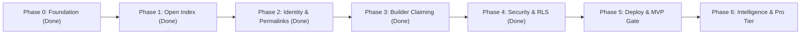

# Publisense — Product & Engineering Roadmap

> [!IMPORTANT]
> **Strategic Thesis**: Win the **community and discovery layer first** (an open, high-craft index where users log friction, share wishlists, and exchange community workarounds for *any* product—without waiting for enterprise buy-in). Once community signal density is undeniable on `/p/:slug` boards, product teams naturally claim their boards to respond, triage, and close the loop.



---

## Current Architecture & State

- **Frontend:** React 19 + Vite 6 + Tailwind 4, Obsidian Dark / Alabaster Light themes, hairline borders (`1px`), `Inter` + `JetBrains Mono` typography.
- **Backend:** Supabase (Postgres + Auth, project `wyjfgrgxmhumyzwcrywj`, region `eu-central-2`).
- **Data Model:** 9 tables (`organizations`, `products`, `profiles`, `posts`, `comments`, `post_votes`, `post_reposts`, `follows`, `notifications`) + `public_profiles` secure view.
- **Access Control:** Production RLS with 32 scoped policies, `handle_new_user` trigger for signup profile creation, and `guard_profile_privileges` privilege escalation prevention.
- **Build Status:** `tsc --noEmit` 0 errors; `vite build` clean.

---

## Phase 0 — Foundation & High-Craft Baseline ✅ *(Completed)*

- [x] **High-Craft UI System** ([`index.css`](./src/index.css), [`ThemeContext.tsx`](./src/context/ThemeContext.tsx)): Obsidian Dark ↔ Alabaster Light themes, `1px` hairline geometry, `28px` workspace gutter, `Inter` + `JetBrains Mono`.
- [x] **Core Open Index & `/p/:slug` Product Pages** ([`HomePage.tsx`](./src/pages/HomePage.tsx)): Symmetrical Hero, Central Omni-Bar (`Search /` ↔ `+ Post C`), Feed Filter Bar, and Right Discovery Rail.
- [x] **Full-Width Signal Card + Bottom Upvote Pill Bar** ([`SignalCard.tsx`](./src/components/SignalCard.tsx)): Highlighted `Top Community Workaround` (indigo) & `Builder Note` (emerald) callouts + inline expandable community threads.
- [x] **Supabase Relational Database & Seed Catalog** ([`schema.sql`](./supabase/schema.sql), [`StoreContext.tsx`](./src/context/StoreContext.tsx)): 8 core relational tables + seed catalog. Firebase completely removed.

---

## Phase 1 — Open Index Polish & Frictionless Community Loop ✅ *(Completed)*

| Milestone | Scope & Deliverables | Target Files |
| :--- | :--- | :--- |
| **1.1 Instant Product Indexing from Omni-Bar** ✅ | Allow users typing an unknown `@Product` directly in the Omni-Bar composer to create + tag that product inline in one step (auto-generating slug & category without leaving the composer). | [`HomePage.tsx`](./src/pages/HomePage.tsx) |
| **1.2 Upvoting & Auto-Pinning Workarounds** ⚠️ | Users can upvote individual replies/workarounds (`likesCount`), automatically promoting the highest-upvoted `'workaround'` comment into the card's `Top Community Workaround` callout box. **The UI works but the vote is silently dropped in production — see [Known Regressions](#-known-regressions-currently-broken-in-production).** | [`SignalCard.tsx`](./src/components/SignalCard.tsx), [`StoreContext.tsx`](./src/context/StoreContext.tsx) |
| **1.3 Duplicate Detection in Omni-Bar** ✅ | As a user types a new signal headline in `+ Post` mode, show live matching existing signals below the bar so they can `+1 / Same Issue` an existing post instead of fragmenting votes. | [`HomePage.tsx`](./src/pages/HomePage.tsx) |
| **1.4 Real-Time 7d Velocity Calculation** ✅ | Computes `7d Velocity` dynamically from `post_votes`, `post_reposts`, and new `posts` timestamps over the trailing 7 days, dynamically driving the Right Rail `Trending Products` leaderboard. | [`HomePage.tsx`](./src/pages/HomePage.tsx), [`StoreContext.tsx`](./src/context/StoreContext.tsx) |

---

## Phase 2 — Real Auth, Permalinks & Social Reputation ✅ *(Completed)*

| Milestone | Scope & Deliverables | Target Files |
| :--- | :--- | :--- |
| **2.1 Supabase Auth (Email / Magic Link / OAuth)** ✅ | Upgraded [`AuthModal`](./src/components/AuthModal.tsx) to support real Supabase Email/Password, Magic Link, and GitHub/Google OAuth sessions with automatic profile hydration and dev persona switching. | [`AuthModal.tsx`](./src/components/AuthModal.tsx), [`StoreContext.tsx`](./src/context/StoreContext.tsx) |
| **2.2 Dedicated Signal Permalinks (`/post/:id`)** ✅ | Dedicated permalink view ([`PostDetailPage.tsx`](./src/pages/PostDetailPage.tsx)) in the high-craft design system with expanded community threads, maintainer triage controls, and related board signals. | [`PostDetailPage.tsx`](./src/pages/PostDetailPage.tsx), [`App.tsx`](./src/App.tsx) |
| **2.3 Contributor Profiles (`/u/:handle`)** ✅ | "Product Sense Portfolio" page ([`ProfilePage.tsx`](./src/pages/ProfilePage.tsx)) showing a user's logged signals, authored workarounds, community impact score, and backed products. | [`ProfilePage.tsx`](./src/pages/ProfilePage.tsx), [`App.tsx`](./src/App.tsx) |
| **2.4 In-App Notifications Drawer** ✅ | Topbar notification bell (`🔔`) with unread count badge, mark-all-read action, and direct navigation to `/post/:id` when signals receive workarounds or status changes. | [`AppShell.tsx`](./src/components/AppShell.tsx), [`StoreContext.tsx`](./src/context/StoreContext.tsx) |

---

## Phase 3 — Builder Claiming & Official Team Loops ✅ *(Completed)*

| Milestone | Scope & Deliverables | Target Files |
| :--- | :--- | :--- |
| **3.1 Domain-Verified Board Claiming** ⚠️ | Allows builders to claim their `/p/:slug` board via company work email domain or DNS TXT record, earning the `✓ Verified Team` badge and maintainer permissions. **UI and client logic are built, but the claim write is rejected by RLS in production — see [Known Regressions](#-known-regressions-currently-broken-in-production).** | [`HomePage.tsx`](./src/pages/HomePage.tsx), [`StoreContext.tsx`](./src/context/StoreContext.tsx) |
| **3.2 Inline Maintainer Triage Controls** ✅ | Verified maintainers can update signal status (`Planned`, `In Progress`, `Shipped`) and author official emerald `Builder Notes` directly from [`SignalCard`](./src/components/SignalCard.tsx) in the feed. | [`SignalCard.tsx`](./src/components/SignalCard.tsx) |
| **3.3 Changelog & "Shipped" Rollup Banner** ✅ | Dedicated summary banner on `/p/:slug` celebrating shipped community requests, tracking team responsiveness rate, and closing the community feedback loop. | [`HomePage.tsx`](./src/pages/HomePage.tsx) |

---

## Phase 4 — Security, Integrity & RLS Lockdown ✅ *(Completed)*

Implemented in migrations `0004`–`0007`:
- [x] **RLS Lockdown (Migration `0006`)**: Replaced all permissive policies with 32 scoped policies: public read for content, `auth.uid()`-gated writes, recipient-only notifications.
- [x] **Signup Trigger (Migration `0004`)**: Added `handle_new_user` on `auth.users` to atomically provision a `profiles` row inside the transaction with handle de-duplication.
- [x] **Privilege Escalation Prevention (Migration `0007`)**: Added `guard_profile_privileges` trigger preventing users from patching their own role to `admin` or changing `managed_org_id`.
- [x] **Privacy Safeguard (Migration `0007`)**: Added `public_profiles` view omitting private email addresses from public reads; updated `StoreContext` loader.

---

## ⚠️ Known Regressions (Currently Broken in Production)

> [!WARNING]
> Phase 4's lockdown is correct, but it **broke two Phase 1/3 features** that were
> written against the permissive-RLS prototype. Both were verified against the live
> database on 2026-10-20 — not inferred from reading code. Tracked as `D-008` and
> `D-009` in [`docs/deferred.md`](./docs/deferred.md).

### 1. Board claiming is rejected by RLS — Phase 3.1

`claimProductBoard()` writes `role: 'maintainer'` and `managed_org_id` to the
caller's own `profiles` row. `guard_profile_privileges` correctly rejects exactly
that, because it is the privilege-escalation path the trigger exists to block:

```
PATCH /rest/v1/profiles?id=eq.<uid>
  {"role":"maintainer","managed_org_id":"org-anthropic"}
→ HTTP 400  P0001  profiles.role cannot be changed by the owner
```

**The guard is right and the client is wrong.** Fix: a `SECURITY DEFINER` RPC —
`claim_product_board(product_id, work_email)` — that verifies the email domain (or
DNS TXT) server-side and performs the role change itself. The client must never
write `role`.

### 2. Comment upvoting silently saves nothing — Phase 1.2

The only UPDATE policy on `comments` is `comments author update`
(`auth.uid() = author_id`). A non-author upvoting someone else's workaround matches
**zero rows and returns success**:

```
PATCH /rest/v1/comments?id=eq.cmt-1  {"likes_count": 43}
→ HTTP 200,  rows affected: 0
```

**Worse than a hard failure** — the UI reports success while persisting nothing, so
it will appear to work during a demo. Fix: a `comment_votes` table (one row per
voter, so `likes_count` becomes an aggregate and one-vote-per-user becomes
enforceable), or a counter RPC.

### Not blocking a read-only launch

Browsing, posting signals, commenting and voting on *signals* (`post_votes`) all
work. Claiming and workaround-upvoting do not. That is fine for a soft launch where
builders are not yet invited to claim boards.

---

## Phase 5 — MVP Deploy Gate *(Current Focus)*

See [`MVP.md`](./MVP.md) and [`docs/deferred.md`](./docs/deferred.md) for shipping criteria.

- [x] **Wire Remaining Page Routes**:
  - `ExplorePage.tsx` (`/explore`), `OrgPage.tsx` (`/org/:slug`), and `SettingsPage.tsx` (`/settings`) routed in [`App.tsx`](./src/App.tsx) and linked via [`AppShell.tsx`](./src/components/AppShell.tsx).
- [x] **Deploy V2 to Production**:
  - Deployed to Vercel at [publisense.vercel.app](https://publisense.vercel.app) with [`vercel.json`](./vercel.json) SPA rewrites, security headers, and production Supabase environment variables.
- [ ] **Auth Email Cleanup / Decision (D-005)**:
  - Either configure Supabase SMTP provider (e.g. Resend) for magic links and email confirmations,
  - Or disable magic-link / unconfirmed paths in [`AuthModal.tsx`](./src/components/AuthModal.tsx) so users aren't offered broken email paths.
- [ ] **Bundle Optimization**:
  - Route-level lazy loading (`React.lazy`) to reduce single chunk size below 500 kB (Issue #9).

---

## Phase 6 — Intelligence & Pro Tier *(Post-MVP)*

- **AI Signal Clustering & Deduplication**: Group related friction reports into thematic clusters on `/p/:slug` using embeddings.
- **Embeddable "Public Sense" Badge**: 1-script high-craft widget (`[▲ 92 Signals on Publisense]`) for product documentation and SaaS footers.
- **Linear / GitHub / Slack Sync (Pro Tier)**: 1-click issue export with bidirectional status synchronization when tickets are completed.
