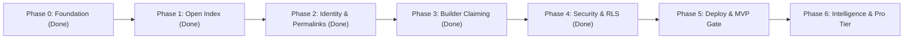

# Publisense — Product & Engineering Roadmap

> [!IMPORTANT]
> **Strategic Thesis**: Win the **community and discovery layer first** (an open, high-craft index where users log friction, share wishlists, and exchange community workarounds for *any* product—without waiting for enterprise buy-in). Once community signal density is undeniable on `/p/:slug` boards, product teams naturally claim their boards to respond, triage, and close the loop.



---

## Current Architecture & State

- **Frontend:** React 19 + Vite 6 + Tailwind 4, Obsidian Dark / Alabaster Light themes, hairline borders (`1px`), `Inter` + `JetBrains Mono` typography.
- **Backend:** Supabase (Postgres + Auth, project `wyjfgrgxmhumyzwcrywj`, region `eu-central-2`).
- **Canonical host:** https://publisense.app (Supabase `site_url` and redirect allow-list point here; `publisense.vercel.app` still resolves).
- **Data Model:** 10 tables (`organizations`, `products`, `profiles`, `posts`, `comments`, `comment_votes`, `post_votes`, `post_reposts`, `follows`, `notifications`) + `public_profiles` secure view.
- **Access Control:** Production RLS with 32 scoped policies, `handle_new_user` trigger for signup profile creation, and `guard_profile_privileges` privilege escalation prevention.
- **Build Status:** `tsc --noEmit` 0 errors; `vite build` clean.

---

## Phase 0 — Foundation & High-Craft Baseline ✅ *(Completed)*

- [x] **High-Craft UI System** ([`index.css`](./src/index.css), [`ThemeContext.tsx`](./src/context/ThemeContext.tsx)): Obsidian Dark ↔ Alabaster Light themes, `1px` hairline geometry, `28px` workspace gutter, `Inter` + `JetBrains Mono`.
- [x] **Core Open Index & `/p/:slug` Product Pages** ([`HomePage.tsx`](./src/pages/HomePage.tsx)): Symmetrical Hero, Central Omni-Bar (`Search /` ↔ `+ Post C`), Feed Filter Bar, and Right Discovery Rail.
- [x] **Full-Width Signal Card + Bottom Upvote Pill Bar** ([`SignalCard.tsx`](./src/components/SignalCard.tsx)): Highlighted `Top Community Workaround` (indigo) & `Builder Note` (emerald) callouts + inline expandable community threads.
- [x] **Supabase Relational Database & Seed Catalog** ([`schema.sql`](./supabase/schema.sql), [`StoreContext.tsx`](./src/context/StoreContext.tsx)): 8 core relational tables + seed catalog. Firebase completely removed.

---

## Phase 1 — Open Index Polish & Frictionless Community Loop ✅ *(Completed)*

| Milestone | Scope & Deliverables | Target Files |
| :--- | :--- | :--- |
| **1.1 Instant Product Indexing from Omni-Bar** ✅ | Allow users typing an unknown `@Product` directly in the Omni-Bar composer to create + tag that product inline in one step (auto-generating slug & category without leaving the composer). | [`HomePage.tsx`](./src/pages/HomePage.tsx) |
| **1.2 Upvoting & Auto-Pinning Workarounds** ✅ | Users can upvote individual replies/workarounds (`likesCount`), automatically promoting the highest-upvoted `'workaround'` comment into the card's `Top Community Workaround` callout box. Persisted via `comment_votes` + a trigger-maintained `likes_count` (migration `0008`, PR #24 — previously the vote was silently dropped). | [`SignalCard.tsx`](./src/components/SignalCard.tsx), [`StoreContext.tsx`](./src/context/StoreContext.tsx) |
| **1.3 Duplicate Detection in Omni-Bar** ✅ | As a user types a new signal headline in `+ Post` mode, show live matching existing signals below the bar so they can `+1 / Same Issue` an existing post instead of fragmenting votes. | [`HomePage.tsx`](./src/pages/HomePage.tsx) |
| **1.4 Real-Time 7d Velocity Calculation** ✅ | Computes `7d Velocity` dynamically from `post_votes`, `post_reposts`, and new `posts` timestamps over the trailing 7 days, dynamically driving the Right Rail `Trending Products` leaderboard. | [`HomePage.tsx`](./src/pages/HomePage.tsx), [`StoreContext.tsx`](./src/context/StoreContext.tsx) |

---

## Phase 2 — Real Auth, Permalinks & Social Reputation ✅ *(Completed)*

| Milestone | Scope & Deliverables | Target Files |
| :--- | :--- | :--- |
| **2.1 Supabase Auth (Email / Magic Link / OAuth)** ✅ | Upgraded [`AuthModal`](./src/components/AuthModal.tsx) to support real Supabase Email/Password, Magic Link, and GitHub/Google OAuth sessions with automatic profile hydration and dev persona switching. | [`AuthModal.tsx`](./src/components/AuthModal.tsx), [`StoreContext.tsx`](./src/context/StoreContext.tsx) |
| **2.2 Dedicated Signal Permalinks (`/post/:id`)** ✅ | Dedicated permalink view ([`PostDetailPage.tsx`](./src/pages/PostDetailPage.tsx)) in the high-craft design system with expanded community threads, maintainer triage controls, and related board signals. | [`PostDetailPage.tsx`](./src/pages/PostDetailPage.tsx), [`App.tsx`](./src/App.tsx) |
| **2.3 Contributor Profiles (`/u/:handle`)** ✅ | "Product Sense Portfolio" page ([`ProfilePage.tsx`](./src/pages/ProfilePage.tsx)) showing a user's logged signals, authored workarounds, community impact score, and backed products. | [`ProfilePage.tsx`](./src/pages/ProfilePage.tsx), [`App.tsx`](./src/App.tsx) |
| **2.4 In-App Notifications Drawer** ✅ | Topbar notification bell (`🔔`) with unread count badge, mark-all-read action, and direct navigation to `/post/:id` when signals receive workarounds or status changes. | [`AppShell.tsx`](./src/components/AppShell.tsx), [`StoreContext.tsx`](./src/context/StoreContext.tsx) |

---

## Phase 3 — Builder Claiming & Official Team Loops ✅ *(Completed)*

| Milestone | Scope & Deliverables | Target Files |
| :--- | :--- | :--- |
| **3.1 Domain-Verified Board Claiming** ✅ | Allows builders to claim their `/p/:slug` board via company work email domain, earning maintainer permissions after human approval. The write goes through `claim_product_board(p_product_id, p_work_email)` (`SECURITY DEFINER`, migration `0009`, PR #25) — the client never writes `role`. A claim **parks as `pending` and grants nothing**; approval is admin-only. No approval UI exists yet — see `D-010` in [`docs/deferred.md`](./docs/deferred.md). | [`HomePage.tsx`](./src/pages/HomePage.tsx), [`StoreContext.tsx`](./src/context/StoreContext.tsx) |
| **3.2 Inline Maintainer Triage Controls** ✅ | Verified maintainers can update signal status (`Planned`, `In Progress`, `Shipped`) and author official emerald `Builder Notes` directly from [`SignalCard`](./src/components/SignalCard.tsx) in the feed. | [`SignalCard.tsx`](./src/components/SignalCard.tsx) |
| **3.3 Changelog & "Shipped" Rollup Banner** ✅ | Dedicated summary banner on `/p/:slug` celebrating shipped community requests, tracking team responsiveness rate, and closing the community feedback loop. | [`HomePage.tsx`](./src/pages/HomePage.tsx) |

---

## Phase 4 — Security, Integrity & RLS Lockdown ✅ *(Completed)*

Implemented in migrations `0004`–`0007`:
- [x] **RLS Lockdown (Migration `0006`)**: Replaced all permissive policies with 32 scoped policies: public read for content, `auth.uid()`-gated writes, recipient-only notifications.
- [x] **Signup Trigger (Migration `0004`)**: Added `handle_new_user` on `auth.users` to atomically provision a `profiles` row inside the transaction with handle de-duplication.
- [x] **Privilege Escalation Prevention (Migration `0007`)**: Added `guard_profile_privileges` trigger preventing users from patching their own role to `admin` or changing `managed_org_id`.
- [x] **Privacy Safeguard (Migration `0007`)**: Added `public_profiles` view omitting private email addresses from public reads; updated `StoreContext` loader.

---

## Verified Production Gaps (as of 2026-10-20 18:50 UTC)

> [!IMPORTANT]
> Both regressions that used to live here are **fixed and verified live**:
> board claiming via `claim_product_board` (PR #25) and comment upvoting via
> `comment_votes` (PR #24). What remains is listed below — check it against the live
> project before any announce, because this file is prose and the database is not.

**Verified working against production** (`wyjfgrgxmhumyzwcrywj`), not inferred:

- unauthenticated read of the seeded catalog: 13 products, 7 organizations, 8 posts, 9 comments
- `public_profiles` serves handles/names/avatars; `profiles` is not publicly readable
- `comment_votes` and `0009`'s RPCs are present; `claim_product_board` / `approve_product_claim` return `401 42501` to `anon`, so they are not callable from the public key
- all 13 products are `claim_status = 'unclaimed'` — no claim has ever been submitted
- V2 live on Vercel, main chunk 102 kB (was 634 kB), route chunks code-split and served

**Still open, in priority order:**

1. **The visible content is all fixture data** — 8 posts, 9 comments and 8 profiles
   are seeded personas with real-looking addresses; zero real members. **Accepted for
   now by owner decision (2026-10-20)** while the product is polished; must be
   revisited before any announce. `D-011`.
2. **Seeded addresses collided with real signups** — a person whose email matched a
   fixture got `HTTP 500 duplicate key … profiles_email_key`, which included the
   owner's own address. Fixed by migration `0010` (fixtures moved to
   `@publisense.invalid`); verified by a magic-link request that now returns `200`.
3. **Sign-in surface** — `AuthModal` asks `/auth/v1/settings` which providers are
   live and renders only those, so no dead controls ship. Email/password and magic
   link both work; auth mail is sent from `auth@publisense.app` with SPF and DKIM
   passing and lands in the inbox. Google OAuth is the one remaining method: it needs
   an OAuth client created in the Google Console (no API exists for it), after which
   the button appears on its own.
4. **Claimed boards are inert** — the approval RPC exists and works, but the only
   `admin` row was an unreachable demo fixture, so nothing could be approved by
   anyone. The owner account is now a real admin (migration `0011`); there is still no
   screen that reaches `approve_product_claim` and no reject path. `D-010`.
5. **Test coverage is narrow** — `npm test` covers the auth-capability logic (15
   cases, in CI), `npm run smoke:live` exercises sign-up, posting, voting and every
   RLS boundary against the live project (14 checks, deletes everything it creates and
   asserts the table counts come back), and CI proves migrations apply, the bundle
   builds and no `service_role` ships. The smoke test cannot run in CI — it needs the
   service role — so it is a deliberate pre-ship step, not an automatic gate. `D-003`.


Browsing, posting signals, commenting, signal voting, and workaround upvoting all
work end to end in production.

### Running the checks

```
npm test          # unit: auth-capability rules (CI)
npm run typecheck # types (CI)
npm run build     # bundle + service_role guard (CI)
npm run smoke:live # live auth + RLS canary; creates a throwaway user, removes it
```

`smoke:live` talks to the production project on purpose. It prints a baseline count
for every table it touches and fails if the counts do not match on the way out; run it
with `-- --keep` to leave the identity behind for inspection.

---

## Phase 5 — MVP Deploy Gate *(Current Focus)*

See [`MVP.md`](./MVP.md) and [`docs/deferred.md`](./docs/deferred.md) for shipping criteria.

- [x] **Wire Remaining Page Routes**:
  - `ExplorePage.tsx` (`/explore`), `OrgPage.tsx` (`/org/:slug`), and `SettingsPage.tsx` (`/settings`) routed in [`App.tsx`](./src/App.tsx) and linked via [`AppShell.tsx`](./src/components/AppShell.tsx).
- [x] **Deploy V2 to Production**:
  - Deployed to Vercel with [`vercel.json`](./vercel.json) SPA rewrites, security headers, and production Supabase environment variables.
  - Custom domain **https://publisense.app** is live on the same project (`www.publisense.app` 308-redirects to the apex); `publisense.vercel.app` keeps serving as the fallback host.
- [x] **Auth Email Cleanup (D-005)**: Supabase SMTP runs through Resend on the app's own verified domain — sender `Publisense <auth@publisense.app>`, SPF/DKIM passing, delivered to the inbox. Magic link is enabled and email confirmation is required again.
- [x] **Bundle Optimization**: route-level lazy loading (`React.lazy`) — main chunk 634 kB → **102 kB** (-84%), with `vendor-react`/`vendor-supabase`/`vendor-router`/`vendor-icons` split out and each page in its own async chunk (Issue #9, PR #26).

---

## Phase 6 — Intelligence & Pro Tier *(Post-MVP)*

- **AI Signal Clustering & Deduplication**: Group related friction reports into thematic clusters on `/p/:slug` using embeddings.
- **Embeddable "Public Sense" Badge**: 1-script high-craft widget (`[▲ 92 Signals on Publisense]`) for product documentation and SaaS footers.
- **Linear / GitHub / Slack Sync (Pro Tier)**: 1-click issue export with bidirectional status synchronization when tickets are completed.
